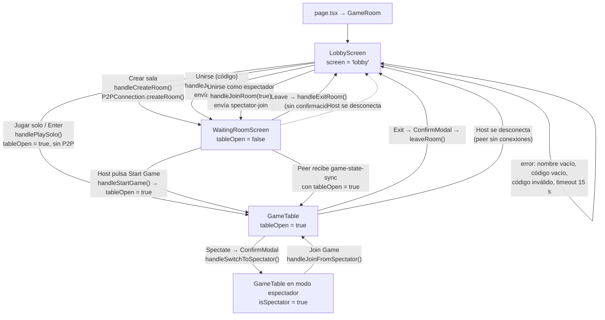
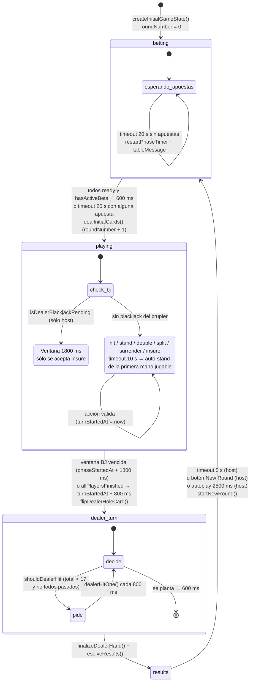
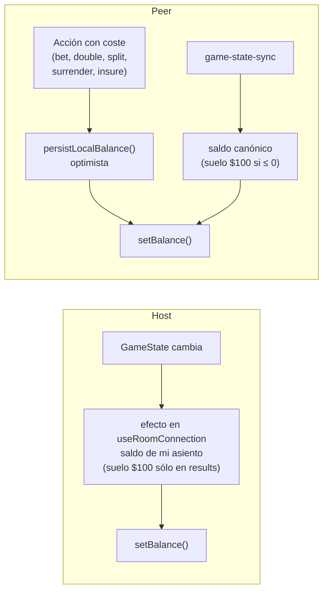
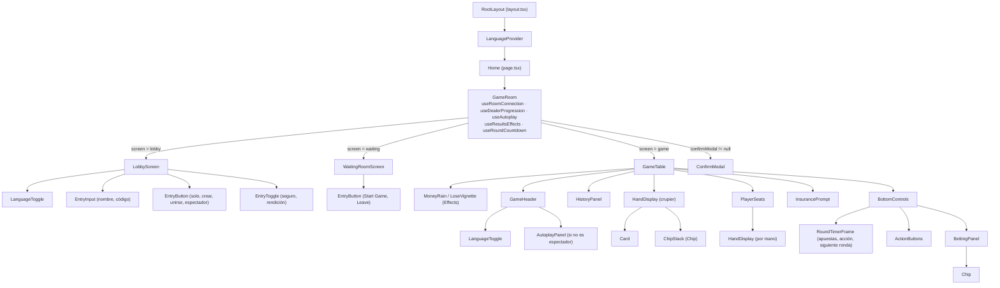

# Flujo de la aplicación (de extremo a extremo)

Este documento describe el flujo de la app **tal como está implementado hoy**, verificado contra el código fuente. Complementa a [`architecture-and-state.md`](architecture-and-state.md) (modelo de estado y red) y a [`casino-rules-and-odds.md`](casino-rules-and-odds.md) (reglas y pagos).

> Los puntos marcados con ⚠️ señalan diferencias u omisiones respecto a `docs/architecture-and-state.md`.

---

## 1. Punto de entrada

```text
src/app/layout.tsx   → <LanguageProvider> envuelve toda la app
src/app/page.tsx     → <GameRoom />
GameRoom.tsx         → enruta a LobbyScreen | WaitingRoomScreen | GameTable
```

- `page.tsx` **no** renderiza `LobbyScreen` directamente: siempre renderiza `GameRoom`, que actúa como **router de pantallas** y orquestador de hooks. Las pantallas son ramas condicionales dentro de `GameRoom`, no rutas de Next.js (hay una sola ruta, `/`).
- `layout.tsx` monta `LanguageProvider` (i18n) e importa `globals.css`. El `<html lang="en">` está fijo aunque el idioma por defecto es español (ver §9).
- Todo es client-side (`'use client'`): no hay API, servidor de juego ni base de datos. PeerJS se usa sólo para señalización WebRTC.

### Hooks que monta `GameRoom` (siempre, en cualquier pantalla)

| Hook | Rol |
| --- | --- |
| `useRoomConnection` | Pantalla actual, sesión P2P, estado canónico (`GameState`), saldo, handlers de sala y mensajes |
| `useResultsEffects` | Sonidos, overlays (lluvia de dinero / viñeta), escritura de historial |
| `useDealerProgression` | Automatización sólo-host: repartir, timeouts, crupier, siguiente ronda |
| `useAutoplay` | Auto-apuesta, hit/stand por umbral, auto-siguiente-ronda (host) |
| `useRoundCountdown` | Valores de cuenta atrás derivados de timestamps del host |
| `useLanguage`, `useIsMobile`, `useViewportHeight` | i18n, detección móvil, variable CSS `--app-height` |

Como los hooks se montan siempre, todos ellos se protegen internamente con comprobaciones de `phase`, `isHostRef` y `myId`.

---

## 2. Pantallas y estado que dirige las transiciones

`useRoomConnection` guarda un estado interno `screen: 'lobby' | 'waiting' | 'game'`, pero **lo que devuelve es una pantalla resuelta**:

```ts
const resolvedScreen = screen === 'lobby' ? 'lobby' : gameState.tableOpen ? 'game' : 'waiting';
```

Consecuencias:

- Fuera del lobby, la pantalla la decide **`gameState.tableOpen`**, no `setScreen`. El `setScreen('game')` de `handleStartGame` es redundante: lo que realmente cambia la pantalla es `tableOpen = true`.
- Los peers pasan de *waiting* a *game* automáticamente cuando reciben un `game-state-sync` con `tableOpen: true`.
- Volver al lobby siempre pasa por `resetRoomState()` (salir, o el host se desconecta).

⚠️ El documento de arquitectura describe el flujo como `lobby -> waiting room -> game table` y dice que la pantalla de espera "existe hasta que el host pone `tableOpen = true`", pero no explica que la pantalla es un valor **derivado** de `tableOpen`, ni que el modo solo salta directamente de *lobby* a *game*.

### 2.1 Diagrama de navegación



> Nota: si un peer se une con el código de una sala cuya mesa ya está abierta, pasa por *waiting* sólo hasta su primer `game-state-sync` (que llega casi inmediatamente) y entra directo a *game*.

### 2.2 `LobbyScreen`

Archivo: `src/features/blackjack/screens/LobbyScreen.tsx`.

| Elemento | Acción | Estado afectado |
| --- | --- | --- |
| Input de nombre (máx. 20) | `setPlayerName` | Persistido en `localStorage['bj_player_name']` por un efecto de `useRoomConnection` ⚠️ (no documentado) |
| Botón **Jugar solo** (es el `submit` del formulario, también con Enter) | `handlePlaySolo()` | `myId = 'solo-player'`, `isHost = true`, `tableOpen = true` → pantalla *game*. No crea `P2PConnection`. |
| **Crear sala** | `handleCreateRoom()` | Crea peer `blackjack-<CODE>` (código de 6 caracteres con CSPRNG), `isHost = true`, host sentado → *waiting*, estado de conexión `Waiting for players...` |
| **Unirse** (revela input de código, máx. 6, mayúsculas) | `handleJoinRoom(false)` | Conecta al host, envía `player-join` con nombre y saldo local → *waiting* con `Waiting for leader...` |
| **Unirse como espectador** | `handleJoinRoom(true)` (si no hay código, sólo abre el input) | `isSpectator = true`, envía `spectator-join` |
| Toggles **Seguro** / **Rendición** | `setRoomSettings` | Sólo aplican si este navegador crea la sala o juega solo; un peer recibe las reglas del host vía `room-settings-sync` |
| Selector de idioma | `setLanguage` | §9 |
| Saldo | sólo lectura | Cargado con `getBalance()` al montar |

- `?room=CODE` en la URL pre-rellena el código y abre el modo *join* del lobby.
- Errores (`error`) se reparten: los que contienen "name" van bajo el nombre; los demás bajo el código. Los textos de error están en inglés y **no** pasan por i18n.
- `splitEnabled` es siempre `true` (no hay toggle). Por defecto seguro y rendición están **desactivados** (`DEFAULT_ROOM_SETTINGS`).

### 2.3 `WaitingRoomScreen`

Archivo: `src/features/blackjack/screens/WaitingRoomScreen.tsx`. Props: `roomCode`, `gameState`, `isHost`, `onStartGame`, `onExitRoom`.

- Muestra el código de sala; al pulsarlo abre un menú **Copy Link** (`?room=CODE`) / **Copy Code**.
- Lista de jugadores de `gameState.players`, host primero, el resto por nombre. Los espectadores no aparecen (no tienen asiento).
- Host: botón **Start Game** → `handleStartGame()`. Invitados/espectadores: sólo **Leave**.
- **Leave** llama directamente a `leaveRoom` (sin `ConfirmModal`, a diferencia de la mesa).

⚠️ Esta pantalla **no usa i18n**: todos sus textos ("Room Code", "Players", "Host", "Start Game", "Leave", "Link copied"…) están en inglés fijo, aunque existen claves `t.waiting.*` en `useLanguage.tsx` que no se usan. Tampoco muestra `connectionStatus` ni los mensajes de prompt host/invitado/espectador que sugieren esas claves.

### 2.4 `GameTable` (pantalla de juego)

Renderizada por `GameRoom` cuando `tableOpen` es `true`. Recibe ~50 props: todo el estado y los handlers vienen de `GameRoom`. Sobre ella puede abrirse `ConfirmModal` (salir / pasar a espectador), que reemplaza a `window.confirm` y avisa si hay una apuesta activa (`hasActiveWager`) que se perderá.

Estado local de UI en `GameRoom` (no replicado):

| Estado | Uso |
| --- | --- |
| `currentBet` | Monto seleccionado con fichas antes de confirmar |
| `soundOn` | Activa/desactiva `sounds` (no persistido) |
| `dismissedInsuranceRound` | Número de ronda en la que se cerró el aviso de seguro |
| `autoplay: AutoplayConfig` | Configuración de autoplay (no persistida; se resetea al salir o pasar a espectador) |
| `confirmModal` | Modal de confirmación activo |
| `bottomOffsetIndex` | Elevación de los controles inferiores (0/48/88 px), persistida en `localStorage['bj_bottom_offset_index']`, por defecto 1 en móvil ⚠️ (no documentado) |

Derivados clave:

- `canAct` = fase `playing` ∧ mano activa con ≥2 cartas ∧ no plantada/pasada/rendida/blackjack ∧ no espectador.
- `waitingForNextRound` (en `GameTable`) = jugador sentado con todas las manos vacías fuera de `betting` → banner "Siguiente ronda".

---

## 3. Ciclo de vida de la ronda

Fases reales (`GamePhase`): `betting`, `playing`, `dealer-turn`, `results`. **No existen fases separadas** para "dealing" ni "insurance": el reparto es una transición atómica `betting → playing` (`dealInitialCards`) y el seguro es una ventana dentro de `playing`.

Todas las transiciones de fase se ejecutan **sólo en el host**, en `useDealerProgression` (más `handleNewRound` y `useAutoplay`). Los peers sólo reciben el resultado vía `game-state-sync`.

### 3.1 Diagrama de estados



### 3.2 Detalle por fase

#### Betting

- El jugador elige fichas (`BettingPanel`: 5, 25, 100, 500, 5000; "All in" = saldo) y confirma → `handleConfirmBetWith(bet)`.
  - Peer: descuento **optimista** del saldo local + mensaje `player-bet`.
  - Host: `sendBet` aplica directamente en `setGameState`.
  - El host valida (`isValidBet`, fase `betting`, no `ready`) y fija `hands[0].bet`, `balance -= bet`, `ready = true`.
- `useRoundCountdown` expone `bettingTimeExpired`, que deshabilita los controles al llegar a 0.
- Transición (host):
  - Todos los jugadores `ready` **y** al menos una apuesta → `dealInitialCards` tras 600 ms.
  - Timeout de 20 s (`BETTING_TIMEOUT_MS`): con apuestas → reparte; sin apuestas → reinicia `phaseStartedAt` y muestra "No bets placed in time. Restarting timer..." (se borra a los 5 s). El texto está en inglés fijo.
  - `dealingRef` evita el doble reparto entre ambas rutas.
- Los jugadores que no apostaron reciben una mano vacía con `stood = true` (quedan fuera de la ronda).

#### Reparto (transición `betting → playing`)

`dealInitialCards()`: reemplaza el zapato si quedan < 60 cartas, reparte 2 cartas a cada jugador con apuesta (marca `blackjack`/`stood` si es natural), 2 al crupier (la segunda boca abajo), `phase = 'playing'`, `roundNumber + 1`. **No** escribe `dealer.blackjack` para no filtrar la carta oculta.

#### Seguro (ventana dentro de `playing`)

- `InsurancePrompt` aparece si: fase `playing`, `insuranceEnabled`, carta visible del crupier es As, el jugador tiene una única mano de 2 cartas sin actuar y sin seguro, y no lo descartó en esta ronda.
- **Comprar** → `handleInsure()`: descuento optimista de `floor(bet/2)` en peers, `sendAction('insure')`, marca `dismissedInsuranceRound`.
- **Rechazar** → `handleDeclineInsurance()`: sólo marca `dismissedInsuranceRound` localmente.
- ⚠️ El documento de arquitectura lista `decline-insurance` como un `player-action` que se envía al host. En el código, `handleDeclineInsurance` **no envía nada**; el caso `decline-insurance` del host es un no-op y `playerDeclineInsurance()` del motor no se usa.
- No hay "peek" explícito: si el host detecta `isDealerBlackjackPending`, durante 1800 ms desde el inicio de la fase sólo acepta `insure`/`decline-insurance`; luego voltea la carta. Si el crupier no tiene blackjack, el seguro se puede comprar mientras la mano siga sin acción, y se pierde al resolver.

#### Turnos de los jugadores

- Acciones: `hit`, `stand`, `double`, `split` (hasta 4 manos), `surrender` (si está activo, sólo con 2 cartas). Los botones se habilitan con `canDoubleDown`, `canSplit`, `canSurrender` en `BottomControls`.
- Todas pasan por `sendAction`: el host aplica `applyActionOnHost`; los peers envían `player-action`. Peers aplican descuentos optimistas en `double`, `split`, `surrender` e `insure`.
- Cada acción válida reinicia `turnStartedAt` (cuenta atrás de 10 s visible en `RoundTimerFrame`).
- `activeHandIndex` avanza con `nextPlayableHandIndex` (las manos divididas que suman 21 se plantan solas; `hit` que llega a 21 también planta).
- **No hay orden de turnos global**: todos los jugadores pueden actuar en paralelo. El timeout de 10 s auto-planta la **primera** mano jugable encontrada en el orden de iteración de `players`. (Coincide con el documento de arquitectura.)
- Fin de turnos: `allPlayersFinished()` → 800 ms después de la última acción, `flipDealerHoleCard()` → `dealer-turn`.

#### Turno del crupier

- `shouldDealerHit`: pide mientras el total sea < 17 (se planta en todos los 17, incluido el blando; `isSoft17()` existe pero no se usa) y no estén todos los jugadores pasados.
- Una carta cada 800 ms (`dealerHitOne`); al plantarse, a los 600 ms `finalizeDealerHand()` (fija `dealer.blackjack`/`busted`, `phase = 'results'`) + `resolveResults()` (pagos por mano + seguro 2:1) en un único `syncGameState`.

#### Resultados

- `useResultsEffects` (una vez por `roundNumber`, no para espectadores): por cada mano, escalonado 600 ms, guarda un registro de historial y reproduce sonido; lluvia de dinero en blackjack (3,5 s), viñeta roja en derrota (0,8 s).
- `BottomControls`: el host ve **New Round** con anillo de 5 s; los invitados ven "Esperando nueva ronda..."; con autoplay activo no se muestra nada.
- Siguiente ronda (sólo host, `handleNewRound`): por timeout de 5 s (`NEXT_ROUND_TIMEOUT_MS`), botón, o autoplay a los 2,5 s. `startNewRound()` limpia manos, `ready = false` y aplica el **suelo de $100** a quien tenga saldo ≤ 0.
- `handleNewRound` también resetea `currentBet` y `dismissedInsuranceRound`, pero **sólo en el host**; en los peers `currentBet` queda con el valor de la ronda anterior (el aviso de seguro funciona igual porque se compara con `roundNumber`).

⚠️ El mensaje `new-round` se describe como "señal legado; el flujo actual se apoya *mayormente* en `game-state-sync`". En realidad `sendNewRound` se exporta desde `useRoomConnection` pero **ningún componente lo llama**: el flujo depende *exclusivamente* de `game-state-sync`. El handler de `new-round` en peers es código muerto.

---

## 4. Multijugador: entradas, salidas y espectadores (resumen de flujo)

| Evento | Qué ocurre |
| --- | --- |
| Peer envía `player-join` | Host sanea nombre/saldo, crea asiento (si la mesa está abierta y la fase ≠ `betting`, con mano plantada y `ready = true` → "se une en la siguiente ronda"), envía `room-settings-sync` sólo a ese peer; el efecto de broadcast envía el estado |
| Peer envía `spectator-join` | Host muestra toast y envía `game-state-sync` dirigido |
| `player-leave` / `player-spectate` | Host elimina el asiento (apuesta perdida) |
| Desconexión de transporte de un peer | Host elimina el asiento y muestra "X disconnected" |
| El host se va o se cae | Cada peer, al quedarse sin conexiones, ejecuta `resetRoomState('The leader left. The room has been closed.')` → lobby |
| Espectador → jugador | `handleJoinFromSpectator`: en peers se usa `pendingJoinRef` y el `isSpectator = false` se aplica al recibir un sync que lo incluye; si la ronda está en curso, estado "Rejoining for next round..." hasta la siguiente fase `betting` |

La topología es una estrella: los peers sólo están conectados al host, por lo que `player-leave` de un peer sólo lo recibe el host (⚠️ el documento de arquitectura lo describe como "any -> room").

---

## 5. Autoplay

Archivos: `hooks/useAutoplay.ts`, `components/AutoplayPanel.tsx`, `types/autoplay.ts`.

Configuración (`AutoplayConfig`, estado local de `GameRoom`, no persistido):

- `enabled`
- `autoBet`: `0` manual, `25`, `50`, `100`, `500`, `-1` all-in
- `standOn`: `15`–`19` (por defecto 17)

El panel aparece en `GameHeader` sólo si no se es espectador.

Comportamiento:

| Efecto | Condición | Acción |
| --- | --- | --- |
| Auto-apuesta | `betting`, `autoBet ≠ 0`, no `ready`, una vez por `phaseStartedAt` | Tras 800 ms, `handleConfirmBetWith(min(autoBet, saldo))` (o todo el saldo) |
| Auto-juego | `autoplayRoundActive` (= `enabled` ∧ no espectador ∧ `playing`) y mano activa sin terminar | Cada 600 ms: `stand` si valor ≥ `standOn`, si no `hit` |
| Seguridad | Mano sin terminar 15 s con autoplay | Fuerza `stand` |
| Auto-siguiente ronda | Host, `results`, autoplay activo | `handleNewRound()` a los 2,5 s (antes que el timeout de 5 s) |

- Con `autoBet ≠ 0` se oculta `BettingPanel`; durante `playing` se sustituyen los botones de acción por el texto "autoplay activo".
- No dobla, no divide, no se rinde ni toma seguro (el comentario del código menciona "double", pero no lo implementa). Si el seguro está activo y el crupier muestra As, el aviso sigue visible hasta que la mano actúa.
- `autoplayRoundActive` se deriva en vivo: activar/desactivar a mitad de mano tiene efecto inmediato.

---

## 6. Historial

Archivos: `lib/history.ts`, `hooks/useResultsEffects.ts`, `components/HistoryPanel.tsx`.

- `localStorage['bj_history']` + firma HMAC-SHA256 en `bj_history_sig`. Firma inválida → se borra todo.
- Máximo 100 registros (`BetRecord`: `round`, `bet`, `result`, `payout`, `balanceAfter`, `timestamp`). Un registro **por mano** (las manos divididas generan varios).
- `balanceAfter` aplica el suelo de $100 si el saldo es ≤ 0.
- Se carga una vez al montar `GameRoom` (`getHistory()`); el estado React se actualiza tras escribir la última mano.
- `HistoryPanel`: botón fijo abajo a la derecha que abre una lista (más reciente primero) formateada con `formatRecord` (texto en inglés: "Bet … -> … (Bal: …)").
- El historial es por navegador, no por sala. `clearHistory()` existe pero no hay UI que lo use. Los espectadores no registran nada.

---

## 7. Persistencia del monedero

Archivo: `lib/wallet.ts`. Claves: `bj_wallet` (JSON `{balance, timestamp, version}`) y `bj_wallet_sig` (HMAC).

`getBalance()`:

- Sin datos → inicializa a **$1000**.
- Firma inválida, JSON roto o saldo ≤ 0 / no finito → **$100**.

Flujo de escritura:



- El saldo que se lleva a una sala lo declara el cliente en `player-join` (el host sólo valida la forma).
- En solo, el jugador es host: el saldo se persiste desde el estado canónico.
- `adjustBalance()` existe pero no se usa.

Observación: en los peers el suelo de $100 se aplica en **cualquier fase**, no sólo en `results`. Un peer que apuesta todo su saldo queda con `balance = 0` en el estado canónico y su monedero local se reescribe a $100 en mitad de la ronda; si cierra la pestaña antes de resolver, conserva esos $100. En el host el suelo sólo se aplica en `results`.

⚠️ El documento de arquitectura dice que "un jugador con 0 o menos también se resetea a $100" sin distinguir dónde; en el código hay tres puntos distintos (`getBalance`, sync de peer en cualquier fase, efecto del host sólo en `results`, además de `startNewRound` en el estado canónico).

---

## 8. Otras preferencias persistidas en `localStorage`

| Clave | Contenido | Dónde |
| --- | --- | --- |
| `bj_wallet`, `bj_wallet_sig` | Saldo firmado | `wallet.ts` |
| `bj_history`, `bj_history_sig` | Historial firmado | `history.ts` |
| `bj_player_name` | Último nombre | `useRoomConnection` |
| `bj_lang` | `en` / `es` | `useLanguage.tsx` |
| `bj_bottom_offset_index` | 0/1/2 | `GameRoom` (con evento `bj-bottom-offset-change`) |

⚠️ El documento de arquitectura sólo documenta monedero e historial.

---

## 9. Internacionalización (i18n)

Archivo: `src/shared/i18n/useLanguage.tsx`.

- Diccionarios en línea `en` y `es` (el tipo `Translations` se infiere de `en`). Secciones: `common`, `lobby`, `waiting`, `game`, `header`, `table`, `betting`, `actions`, `autoplay`, `hand`, `controls`, `history`, `seats`, etc.
- `LanguageProvider` usa `useSyncExternalStore` sobre `localStorage['bj_lang']`, escuchando `storage` (otras pestañas) y el evento propio `bj-language-change`. **Idioma por defecto: español** (también en el snapshot de servidor).
- `useLanguage()` devuelve `{ language, setLanguage, t }`; lanza error fuera del provider.
- `LanguageToggle` aparece en el lobby y en `GameHeader`.

Textos que **no** pasan por i18n (siempre en inglés):

- Toda `WaitingRoomScreen`.
- Errores del lobby (`Enter your name!`, `Failed to join: …`), `connectionStatus` y toasts (`X joined!`, `Table open`, `Connected!`…).
- `tableMessage` del host ("No bets placed in time…").
- Formato de registros del historial (`formatRecord`).
- `<html lang="en">` fijo en `layout.tsx`.

⚠️ El documento de arquitectura no tiene ninguna sección sobre i18n.

---

## 10. Árbol de componentes



`GameHeader` tiene dos maquetaciones (escritorio y móvil) con un menú de ajustes (sonido, elevación de controles, copiar enlace, espectar, salir).

---

## 11. Resumen de discrepancias con `architecture-and-state.md`

| # | Tema | Documento | Código |
| --- | --- | --- | --- |
| 1 | Navegación | `lobby -> waiting -> game` | Pantalla derivada de `tableOpen`; solo salta del lobby a *game*; peers entran a *game* por sync |
| 2 | `decline-insurance` | `player-action` enviado al host | Sólo local; nunca se envía |
| 3 | `new-round` | "mayormente" sin usar | `sendNewRound` nunca se llama; código muerto |
| 4 | `player-leave` | `any -> room` | Peer → host (topología estrella) |
| 5 | Suelo de $100 | Regla única | Aplicado en 4 sitios con criterios distintos; en peers en cualquier fase |
| 6 | Persistencia | Sólo monedero e historial | Además `bj_player_name`, `bj_lang`, `bj_bottom_offset_index` |
| 7 | i18n | No documentado | `LanguageProvider`, español por defecto, sala de espera y mensajes sin traducir |
| 8 | Fases | — | No hay fases "dealing" ni "insurance"; ambas viven en transiciones/ventanas de `playing` (el doc lo menciona en §14, correcto) |
