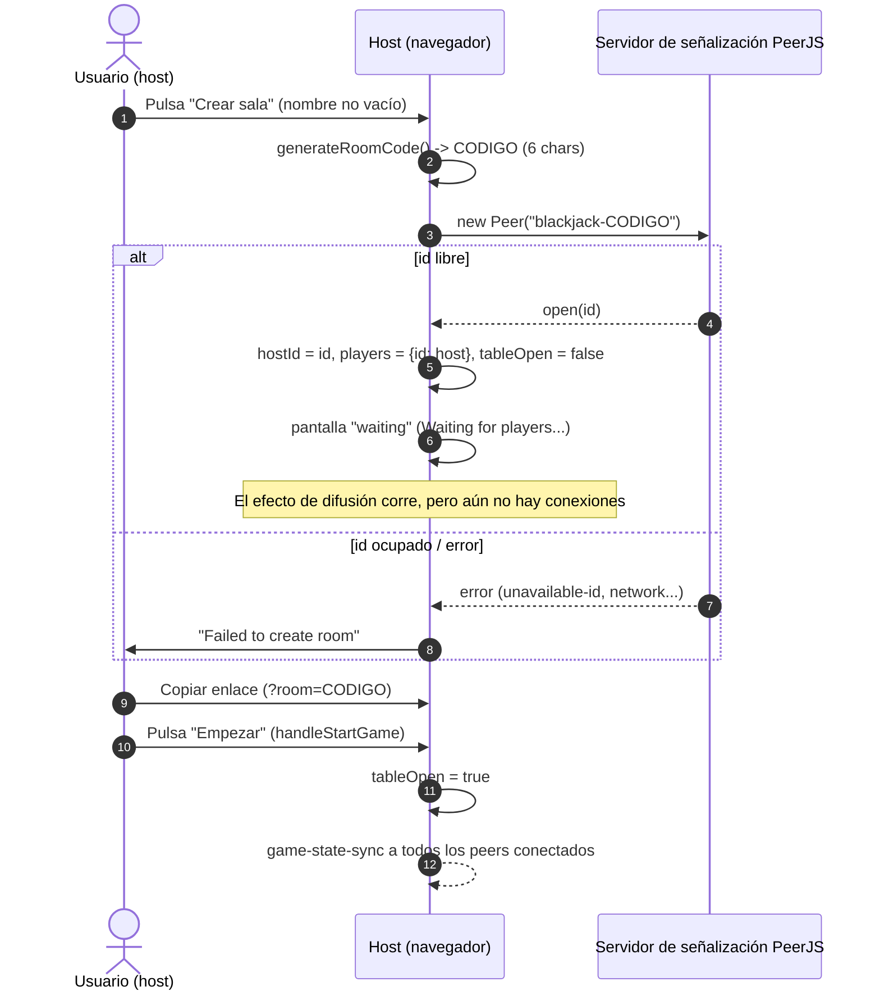
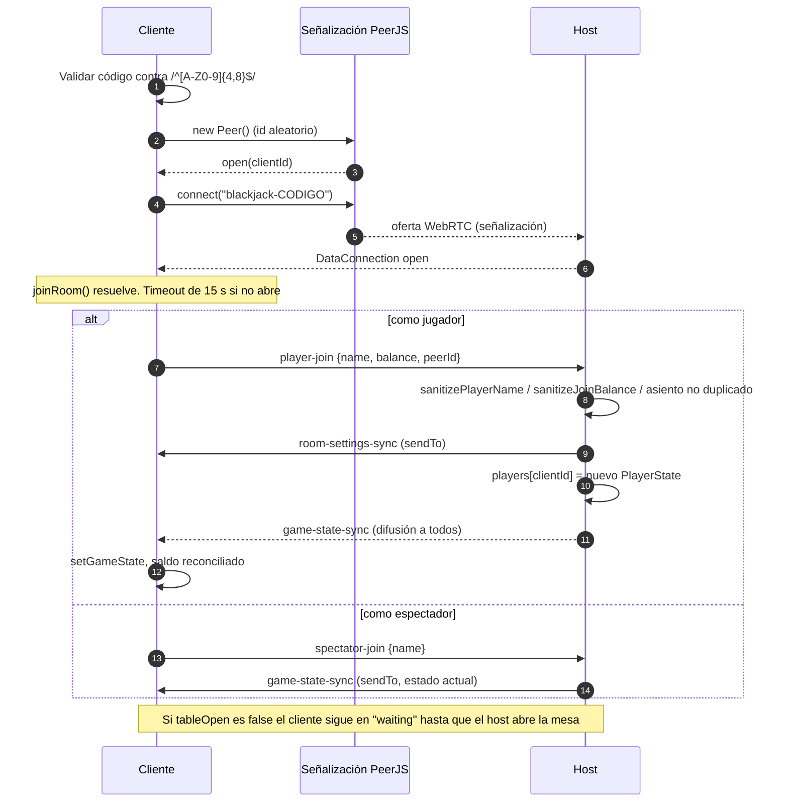
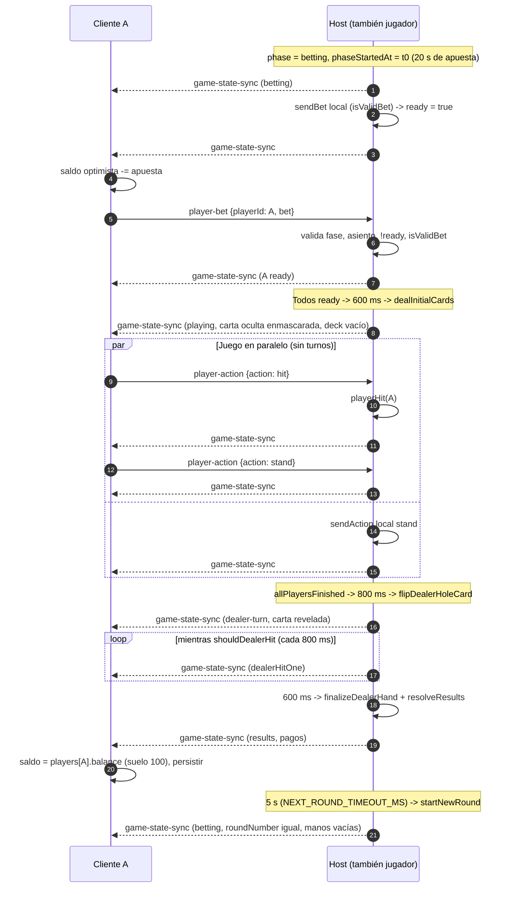
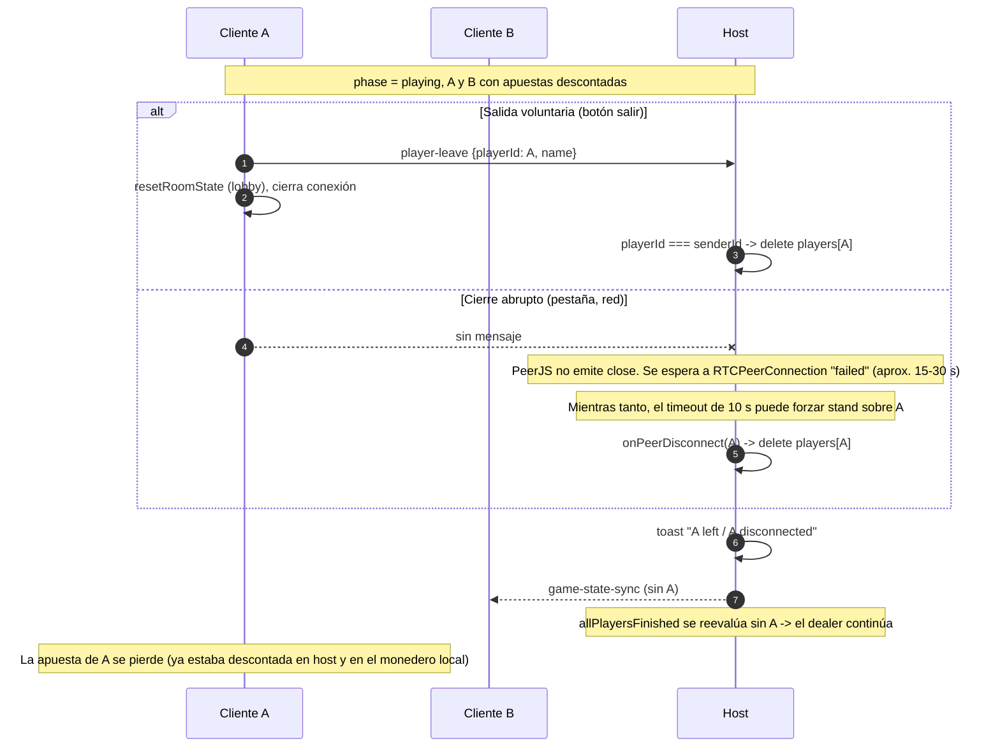
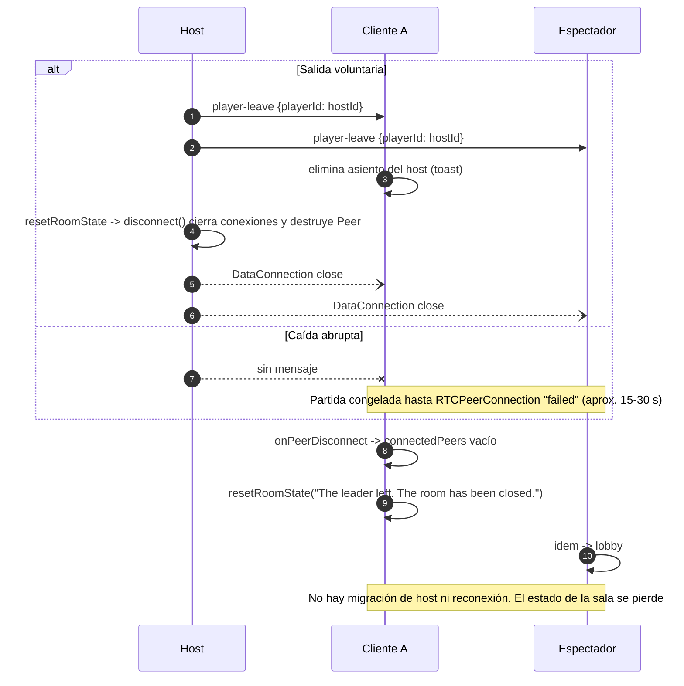

# Protocolo de red P2P

> Referencia del protocolo de mensajes entre navegadores de Blackjack Online.
> Pensado para vivir en `docs/network-protocol.md`.
>
> Fuentes: `src/features/blackjack/lib/p2p.ts`, `src/features/blackjack/hooks/useRoomConnection.ts`,
> `src/features/blackjack/lib/validation.ts`, `src/features/blackjack/hooks/useDealerProgression.ts`,
> `src/features/blackjack/screens/GameRoom.tsx`, `src/features/blackjack/lib/blackjack.ts`
> (`sanitizeStateForBroadcast`, reductores de acciones). PeerJS `1.5.5`.

---

## 1. Topología

**Estrella con host autoritativo.**

```
            +-----------------------------+
            |  Host  (peer id blackjack-<CODIGO>)  |
            |  - GameState canónico (con mazo)    |
            |  - timers de fase / dealer          |
            +-----------------------------+
              ^   |        ^   |        ^   |
   intents    |   | state  |   |        |   | state
              |   v        |   v        |   v
          Jugador A    Jugador B     Espectador
```

- El host registra en el servidor de señalización PeerJS el id fijo `blackjack-<CODIGO>`, donde
  `<CODIGO>` son 6 caracteres de `[A-Z0-9]` generados con `crypto.getRandomValues`
  (`generateRoomCode`). Si el id ya existe, PeerJS emite `unavailable-id` y `createRoom()` rechaza.
- Cada cliente (jugador o espectador) crea un `Peer` con id aleatorio asignado por el servidor y abre
  **una única `DataConnection`** hacia `blackjack-<CODIGO>`. Los clientes **nunca** se conectan entre sí.
- Solo el host ejecuta el motor de reglas (`blackjack.ts`), los temporizadores
  (`useDealerProgression`) y mantiene el mazo. Los clientes envían *intenciones* y reemplazan su
  estado completo con cada snapshot recibido.
- El servidor de señalización es la nube pública de PeerJS por defecto, o el configurado con
  `NEXT_PUBLIC_PEERJS_HOST` / `_PORT` / `_PATH` / `_KEY` / `_SECURE`. Solo se usa para el
  establecimiento WebRTC; ningún mensaje de juego pasa por él.
- Modo solitario (`handlePlaySolo`): no se crea `P2PConnection`; `p2pRef` es `null`, el jugador es
  host con id `solo-player` y no se envía nada por la red.

### Transporte

| Aspecto | Valor efectivo | Origen |
| --- | --- | --- |
| Canal | `RTCDataChannel` de PeerJS | `peer.connect(...)` sin opciones |
| Serialización | `"default"` de PeerJS 1.5 (BinaryPack, con troceado a ~16 KB) | `connect()` aplica `serialization: "default"` |
| Orden | **No ordenado** (`ordered: !!options.reliable` y `reliable` no se pasa → `ordered: false`) | `bundler.mjs` de PeerJS |
| Fiabilidad | Retransmisión SCTP completa (no se fija `maxRetransmits` ni `maxPacketLifeTime`) | WebRTC por defecto |
| Envío | `send()` = difusión a todas las conexiones abiertas; `sendTo(peerId)` = unicast | `P2PConnection` |

Como cada cliente solo tiene una conexión (al host), `send()` en un cliente equivale a "enviar al host".
En el host, `send()` difunde a **todos** los peers conectados, incluidos espectadores y peers que aún
no se han presentado con `player-join`/`spectator-join`.

---

## 2. Sobre de mensaje

```ts
type MessageType =
  | 'player-join' | 'spectator-join' | 'player-bet' | 'player-action'
  | 'game-state-sync' | 'new-round' | 'player-leave' | 'player-spectate'
  | 'room-settings-sync' | 'chat';

interface GameMessage {
  type: MessageType;
  payload: unknown;
  senderId: string;   // reescrito por el receptor
  timestamp: number;  // Date.now() del emisor
}
```

Reglas del sobre (`P2PConnection.setupConnection` / `send` / `sendTo`):

1. **`senderId` nunca se confía.** Al recibir, se sobrescribe con `conn.peer` (el id del peer de
   transporte). Los valores que pone el emisor (`'host'`, `myId`) son irrelevantes. Por eso todas las
   comprobaciones de identidad usan `msg.senderId`.
2. **`timestamp`** lo fija el emisor con `Date.now()`. El receptor lo conserva si es `number`; si no,
   lo sustituye por su propio `Date.now()`. Ningún handler lo usa.
3. No hay campo de versión, id de mensaje, número de secuencia ni id de sala.
4. Un `type` desconocido cae fuera del `switch` de `handleMessage` y se ignora en silencio.

---

## 3. Catálogo de mensajes

Leyenda de dirección: **C→H** cliente a host, **H→C** host a cliente(s), **H→1** host a un único
cliente (`sendTo`), **H→*** difusión del host.

### 3.1 Resumen

| Tipo | Dirección | Payload | Cuándo se envía | Quién lo procesa |
| --- | --- | --- | --- | --- |
| `player-join` | C→H | `{ name: string; balance: number; peerId: string }` | Al unirse como jugador (`handleJoinRoom`) o al pasar de espectador a jugador (`handleJoinFromSpectator`) | Solo host |
| `spectator-join` | C→H | `{ name: string }` | Al unirse como espectador (`handleJoinRoom(true)`) | Host (los clientes nunca lo reciben) |
| `player-bet` | C→H | `{ playerId: string; bet: number }` | Al confirmar apuesta (`handleConfirmBetWith` → `sendBet`), también desde autoplay | Solo host |
| `player-action` | C→H | `{ playerId: string; action: PlayerActionKind }` | Pulsar hit / stand / double / split / surrender / insure (`sendAction`) | Solo host |
| `player-leave` | C→H y H→* | `{ playerId: string; name: string }` | Al salir de la sala (`handleExitRoom`), tanto cliente como host | Cualquiera |
| `player-spectate` | C→H | `{ playerId: string; name: string }` | Jugador cliente pasa a espectador (`handleSwitchToSpectator`) | Cualquiera (en la práctica, host) |
| `game-state-sync` | H→* y H→1 | `GameState` saneado | Cada commit de `gameState` en el host (difusión); y unicast a un espectador al recibir `spectator-join` | Solo clientes |
| `room-settings-sync` | H→1 | `RoomSettings` | Al sentar a un jugador nuevo en respuesta a `player-join` | Solo clientes |
| `new-round` | (H→*) | `{}` | **Nunca en el flujo actual**: `sendNewRound` se exporta pero ningún componente lo llama | Solo clientes, si `senderId === hostId` |
| `chat` | — | — | **Reservado**: declarado en `MessageType`, sin emisor ni handler | Nadie |

`PlayerActionKind = 'hit' | 'stand' | 'double' | 'split' | 'surrender' | 'insure' | 'decline-insurance'`.
`'decline-insurance'` existe en el tipo y el host lo trata como no-op, pero la UI actual
(`handleDeclineInsurance`) **no lo envía**: solo oculta el aviso localmente.

### 3.2 Detalle y validación

#### `player-join` (C→H)

- **Emisor:** `useRoomConnection.handleJoinRoom` (tras `joinRoom()` resuelto) y
  `handleJoinFromSpectator`. `balance` sale del monedero local (`getBalance()`); `peerId` es el propio
  id (no se usa en el host).
- **Validación en el host:**
  1. Se ignora si el receptor no es host.
  2. `name` → `sanitizePlayerName`: debe ser `string`; se recorta y trunca a 20 caracteres
     (`MAX_PLAYER_NAME_LENGTH`); vacío → se descarta el mensaje entero.
  3. `balance` → `sanitizeJoinBalance`: si no es número finito ≥ 0 se usa `INITIAL_BALANCE` (1000);
     si no, `Math.floor` y tope de `MAX_JOIN_BALANCE` (1 000 000). **El saldo es declarado por el
     cliente por diseño** (monedero local), solo se acota.
  4. Si ya existe un asiento para `senderId`, se ignora (evita reembolsar una apuesta ya aplicada o
     restaurar un saldo). En ese caso tampoco se envía `room-settings-sync`.
- **Efecto:** se crea `PlayerState` con clave `senderId`. Si `tableOpen && phase !== 'betting'`
  (unión a mitad de ronda), la mano se crea con `stood: true` y `ready: true` (espera a la siguiente
  ronda; `dealInitialCards` lo excluye porque `bet === 0`).
- **Respuesta:** `room-settings-sync` (unicast, inmediato) + `game-state-sync` (difusión, cuando el
  estado hace commit). No hay mensaje de rechazo: un join inválido simplemente no recibe respuesta y el
  cliente queda en "Waiting for leader...".

#### `spectator-join` (C→H)

- **Validación:** `name` pasa por `sanitizePlayerName` solo para el toast; un nombre inválido no
  impide la respuesta.
- **Respuesta:** `game-state-sync` unicast con `sanitizeStateForBroadcast(gameStateRef.current)`.
- El host **no registra** a los espectadores en ninguna lista; son simplemente conexiones sin asiento.

#### `player-bet` (C→H)

- **Validación en el host:** receptor es host; `payload.playerId === senderId`; dentro del updater:
  `phase === 'betting'`, existe el asiento, `!player.ready`, e `isValidBet(bet, player.balance)`
  (número, entero seguro, `> 0`, `<= balance`; rechaza `NaN`, decimales, negativos, `Infinity`).
- **Efecto:** `hands[0].bet = bet`, `balance -= bet`, `ready = true`, borra `tableMessage`.
- **Rechazo:** silencioso (estado sin cambios → sin difusión). El cliente ya descontó la apuesta de su
  saldo de forma optimista; el siguiente `game-state-sync` lo corrige.

#### `player-action` (C→H)

- **Validación en el host:** receptor es host; `payload.playerId === senderId`;
  `gameStateRef.current.phase === 'playing'`; en `applyActionOnHost`, si el dealer tiene un blackjack
  oculto pendiente (`isDealerBlackjackPending`) solo se aceptan `insure` / `decline-insurance`.
  Después, cada reductor (`playerHit`, `playerStand`, `playerDoubleDown`, `playerSplit`,
  `playerSurrender`, `playerInsure`) revalida fase, existencia del jugador, estado de la mano, saldo y
  ajustes de sala (`splitEnabled`, `surrenderEnabled`, `insuranceEnabled`). Un `action` desconocido cae
  en `default` y no hace nada (no hay comprobación de tipo en tiempo de ejecución más allá del `switch`).
- **No hay turnos:** los reductores no comprueban "a quién le toca"; todos los jugadores juegan sus
  manos en paralelo. El temporizador de 10 s (`PLAYER_ACTION_TIMEOUT_MS`, anclado a `turnStartedAt`,
  que se reinicia con cualquier acción) fuerza `stand` del **primer** jugador con mano accionable.
- **Rechazo:** silencioso, igual que las apuestas. `double` / `split` / `surrender` / `insure` aplican
  un ajuste optimista al saldo local del cliente en `GameRoom.tsx` antes de enviar.

#### `player-leave` (C→H, y H→* cuando sale el host)

- **Validación:** `payload.playerId === senderId` (un peer solo puede quitarse a sí mismo). El nombre
  del toast se toma del estado local, nunca de `payload.name`.
- **Efecto:** se elimina `players[senderId]`. La apuesta en curso se pierde (ya estaba descontada).
- Lo procesan host **y** clientes: cuando el host sale, difunde `player-leave` con su propio id, los
  clientes quitan el asiento del host y, acto seguido, el cierre del transporte provoca el reseteo.

#### `player-spectate` (C→H)

- **Validación y efecto:** idénticos a `player-leave` (eliminar el asiento de `senderId`), con otro
  toast. El cliente elimina además su asiento localmente de forma optimista. El host, cuando él mismo
  pasa a espectador, no envía nada: modifica su estado y la difusión normal lo propaga.

#### `game-state-sync` (H→*, H→1)

- **Emisor:** efecto de `useRoomConnection` que se dispara en cada cambio de `gameState` en el host
  (incluidas todas las transiciones de `useDealerProgression`). Payload =
  `sanitizeStateForBroadcast(gameState)`:
  - `deck: []` (el mazo nunca sale del host),
  - cartas boca abajo (carta oculta del dealer y cualquier carta `faceUp: false` de jugadores)
    sustituidas por `HIDDEN_CARD`,
  - `dealer.blackjack` no se fija al repartir para no filtrar la carta oculta.
- **Forma (`GameState`):** `phase: 'betting' | 'playing' | 'dealer-turn' | 'results'`,
  `phaseStartedAt: number`, `turnStartedAt: number`, `deck: Card[]`, `dealer: Hand`,
  `players: Record<string, PlayerState>`, `roundNumber: number`, `settings: RoomSettings`,
  `tableOpen: boolean`, `hostId: string`, `hostName: string`, `tableMessage?: { text; id }`.
- **Procesamiento en el cliente:** si no es host, `setGameState(payload)` **sin validación alguna** y
  sin comprobar `senderId === hostId` (la topología garantiza que solo el host puede enviarlo).
  Además: limpia banners de conexión si `tableOpen`; reconcilia el saldo mostrado con
  `players[myId].balance` (suelo de 100 si ≤ 0) y lo persiste si cambió; si había una unión desde
  espectador pendiente (`pendingJoinRef`) y el jugador ya aparece, cambia a modo jugador.
- Es un **snapshot completo**, no un delta. Los temporizadores de la UI cliente
  (`useRoundCountdown`) calculan con `phaseStartedAt` / `turnStartedAt`, que son marcas del reloj del
  host.

#### `room-settings-sync` (H→1)

- **Payload:** `RoomSettings = { insuranceEnabled: boolean; surrenderEnabled: boolean; splitEnabled: boolean }`.
- **Cuándo:** solo como respuesta a un `player-join` aceptado. Los ajustes se eligen en el lobby antes
  de crear la sala y no cambian después; además viajan dentro de cada `game-state-sync`
  (`settings`), por lo que este mensaje es redundante.
- **Procesamiento:** cliente no host → `setRoomSettings` y `gameState.settings`, sin validar.

#### `new-round` (heredado)

- Handler en cliente: si `senderId === gameState.hostId` y `phase === 'results'`, aplica
  `startNewRound` localmente. Hoy no se envía nunca: el host avanza de ronda con `startNewRound` en su
  propio estado (`handleNewRound`, disparado por el temporizador de resultados de 5 s) y la difusión de
  `game-state-sync` lo propaga.

---

## 4. Diagramas de secuencia

### 4.1 Crear sala



### 4.2 Unirse a la sala (jugador y espectador)



### 4.3 Ronda completa con 2 jugadores (host H juega + cliente A)



Notas: si nadie apuesta en 20 s, el host reinicia `phaseStartedAt` y pone un `tableMessage` (ambos
viajan por `game-state-sync`). Si algún jugador no actúa en 10 s, el host fuerza `stand`.

### 4.4 Un jugador se desconecta a mitad de ronda



### 4.5 El host se desconecta



---

## 5. Garantías actuales

- **Identidad ligada al transporte:** `senderId` se reescribe con `conn.peer`; todas las operaciones
  sobre asientos exigen `payload.playerId === senderId`.
- **Host autoritativo:** clientes no pueden modificar el estado de otros; toda transición la calcula
  el host con reductores puros que revalidan reglas, fase y saldo.
- **Entradas acotadas:** nombre (≤ 20 caracteres), saldo inicial (entero, 0 a 1 000 000), apuesta
  (entero seguro positivo ≤ saldo). Cubierto por `validation.test.ts`.
- **Ocultación de información:** el mazo y las cartas boca abajo nunca se envían.
- **Rechazo silencioso sin amplificación:** un mensaje inválido no cambia la identidad del estado, por
  lo que no provoca difusión ni reprograma temporizadores.
- **Unión idempotente:** un `player-join` repetido para un asiento existente se ignora.

---

## 6. Carencias y riesgos

| # | Carencia | Consecuencia | Sugerencia |
| --- | --- | --- | --- |
| 1 | **Sin versionado** del protocolo ni del esquema de `GameState` | Host y cliente con builds distintos pueden interpretar mal el snapshot sin aviso | Campo `v` en el sobre y mensaje de rechazo `version-mismatch` |
| 2 | **Sin ack ni respuestas de error** | Apuestas/acciones rechazadas o joins inválidos no reciben feedback; el cliente depende del siguiente snapshot y puede quedarse en "Waiting for leader..." | Mensaje `error {code, ref}` o ack por id de mensaje |
| 3 | **Canal no ordenado** (`reliable` no se pasa → `ordered: false`) y **sin número de secuencia** | Dos `game-state-sync` seguidos (p. ej. pasos del dealer cada 800 ms) pueden llegar invertidos y el cliente aplicaría un snapshot antiguo como definitivo | Pasar `{ reliable: true }` en `connect()` y/o añadir `seq` monotónico y descartar snapshots viejos |
| 4 | **`game-state-sync` y `room-settings-sync` se aplican sin validar** | Confianza total en el host (aceptable por diseño, pero un host modificado puede enviar cualquier estado, saldos incluidos, que el cliente persiste en su monedero) | Validación de esquema mínima en cliente; aceptar solo si `senderId === hostId` |
| 5 | **Desestructuración de payload sin guardas** en `player-bet`, `player-action`, `player-leave`, `player-spectate` (`const { … } = msg.payload`) | Un payload `null`/`undefined` lanza `TypeError` dentro del handler `data` (el mensaje se pierde y se registra un error; no tumba la sala) | Usar `msg.payload ?? {}` como en `player-join` |
| 6 | **`action` no se valida en tiempo de ejecución** | Valores arbitrarios caen en `default` (inocuo hoy, frágil si se añaden casos) | Lista blanca explícita |
| 7 | **Detección de caídas lenta** (sin heartbeat): depende de ICE `failed`, ~15-30 s | Partida congelada hasta que expira; el temporizador de 10 s solo fuerza `stand` a un jugador cada vez | Ping/pong de aplicación con timeout corto |
| 8 | **Sin reconexión ni migración de host** | Caída o recarga del host destruye la sala; un cliente que recarga obtiene otro peer id y pierde su asiento y su apuesta | Token de sesión para reclamar asiento; host de respaldo |
| 9 | **Saldo de entrada declarado por el cliente** | Cualquiera puede unirse con hasta 1 000 000 | Limitación de diseño del monedero local; documentarla o firmar saldos en host |
| 10 | **Conexiones anónimas reciben estado** | El host acepta cualquier `DataConnection` y le difunde snapshots aunque nunca envíe `join`; no hay límite de peers ni de tasa | Exigir `join` antes de difundir; tope de asientos/conexiones; rate limiting |
| 11 | **Snapshots completos en cada cambio** | Tráfico O(jugadores × cambios); con muchos peers y mensajes frecuentes puede saturar el buffer de PeerJS (8 MB) | Deltas o compresión si crece la mesa |
| 12 | **Relojes del host en el payload** (`phaseStartedAt`, `turnStartedAt`) | Con desfase de reloj, las cuentas atrás de los clientes son inexactas (se mitiga con `Math.max(now, startedAt)`) | Enviar duración restante o estimar offset |
| 13 | **`timestamp` del sobre sin uso** y controlado por el emisor | Ruido; no sirve para ordenar | Eliminar o sustituir por `seq` |
| 14 | **Mensajes muertos o reservados**: `new-round` (sin emisor), `chat` (sin handler), `decline-insurance` (no se envía), `peerId`/`name` en payloads (ignorados), `room-settings-sync` (redundante con `GameState.settings`) | Superficie de protocolo mayor que la usada | Retirar o implementar |
| 15 | **Espectadores no registrados** en el host | No hay recuento ni nombres de espectadores; el host no sabe quién mira | Lista `spectators` en estado |
| 16 | **Sin cifrado de extremo a extremo propio / autenticación de sala** | Cualquiera con el código (6 chars, 36^6 combinaciones) puede entrar; DTLS de WebRTC protege el canal pero no autentica | Código más largo o contraseña de sala |

---

## 7. Constantes relevantes

| Constante | Valor | Archivo |
| --- | --- | --- |
| Prefijo de peer id del host | `blackjack-` | `p2p.ts` |
| Longitud / alfabeto del código | 6 / `A-Z0-9` | `p2p.ts` |
| Patrón aceptado al unirse | `/^[A-Z0-9]{4,8}$/` | `validation.ts` |
| Timeout de unión | 15 000 ms | `p2p.ts` |
| `MAX_PLAYER_NAME_LENGTH` | 20 | `validation.ts` |
| `MAX_JOIN_BALANCE` | 1 000 000 | `validation.ts` |
| `INITIAL_BALANCE` (fallback) | 1000 | `wallet.ts` |
| `BETTING_TIMEOUT_MS` | 20 000 | `blackjack.ts` |
| `PLAYER_ACTION_TIMEOUT_MS` | 10 000 | `blackjack.ts` |
| `NEXT_ROUND_TIMEOUT_MS` | 5 000 | `blackjack.ts` |
| Retardos del dealer | 600 ms (reparto), 1800 ms (BJ oculto), 800 ms (revelar / pedir), 600 ms (resolver) | `useDealerProgression.ts` |
| Suelo de saldo tras quiebra | 100 | `useRoomConnection.ts`, `blackjack.ts` |
